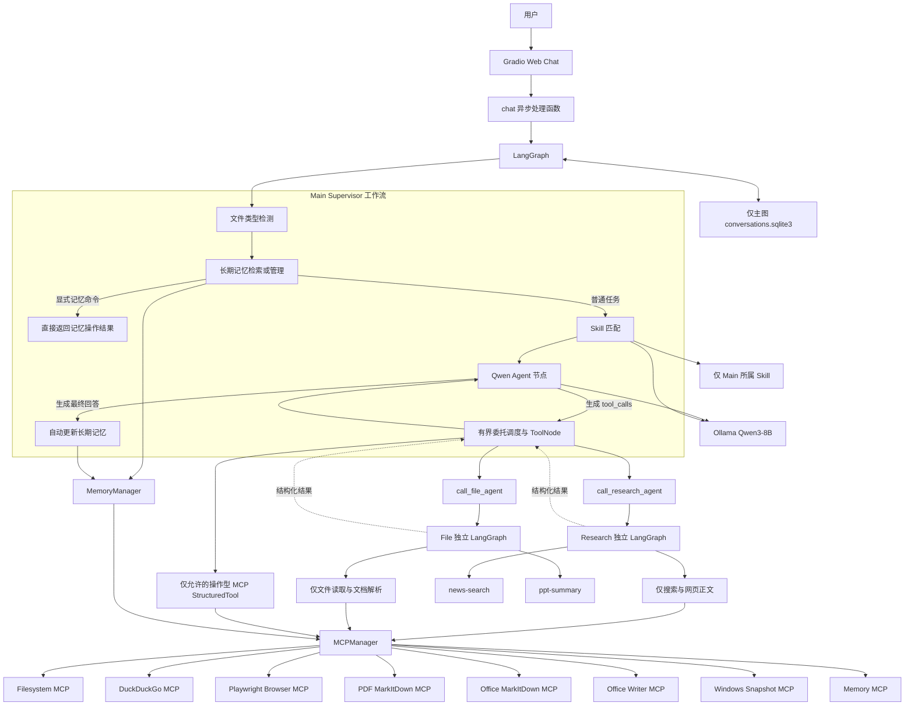
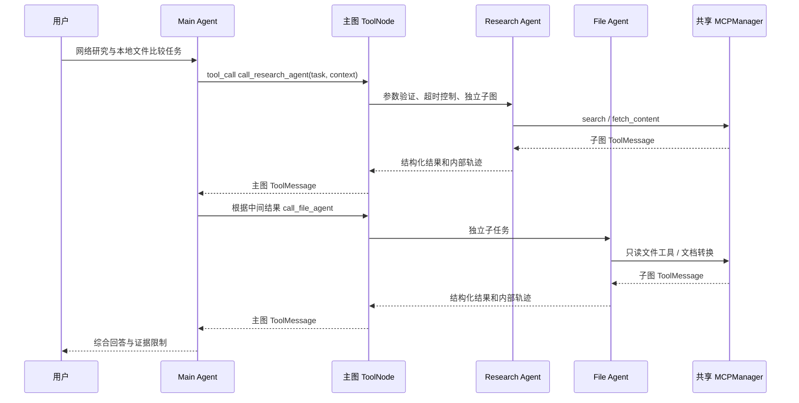
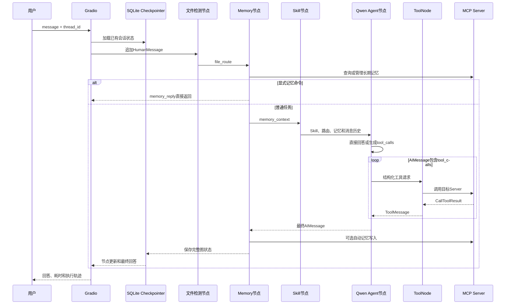

# Local Personal Agent

一个运行在 Windows 本地电脑上的个人智能体系统。

项目使用本地 Ollama `Qwen3-8B` 作为大语言模型，通过 LangGraph 组织 Agent 工作流，通过 MCP 接入文件系统、网络搜索、浏览器、PDF、Office、长期记忆和屏幕观察能力，并使用 Gradio 提供 Web 聊天界面。

> 当前实现为第一版多 Agent：保留主 Agent 及原有 MCP 循环，通过 Agent-as-Tool 委托独立的 Research Agent 和 File Agent。主 Agent 动态决定委托顺序，专业 Agent 不直接互调。

## 目录

- [当前能力](#当前能力)
- [技术栈](#技术栈)
- [整体架构](#整体架构)
- [多 Agent 协作](#多-agent-协作)
- [目录结构](#目录结构)
- [启动流程](#启动流程)
- [一次请求的完整执行链路](#一次请求的完整执行链路)
- [任务识别与工具路由](#任务识别与工具路由)
- [Agent 运行机制](#agent-运行机制)
- [MCP 工具体系](#mcp-工具体系)
- [Skill 机制](#skill-机制)
- [Memory 与会话管理](#memory-与会话管理)
- [配置与持久化](#配置与持久化)
- [异常处理与安全边界](#异常处理与安全边界)
- [已知问题与限制](#已知问题与限制)
- [安装与启动](#安装与启动)
- [使用示例](#使用示例)
- [测试说明](#测试说明)
- [核心代码阅读顺序](#核心代码阅读顺序)

## 当前能力

### 已实现

- 使用 Ollama 本地运行 `qwen3:8b`。
- 使用 Gradio 提供本地 Web 聊天页面。
- 使用 LangGraph 管理消息状态和工具调用循环。
- 通过 Filesystem MCP 访问本地 D 盘文件系统。
- 通过 DuckDuckGo MCP 搜索网络并抓取网页正文。
- 通过隔离的 Playwright Edge 浏览器读取网页。
- 将 PDF、DOCX、XLSX、PPTX 转换成 Markdown 后交给模型分析。
- 通过项目自带的 MCP Server 创建并验证 DOCX 文件。
- 通过 Windows MCP 获取当前屏幕的结构化快照。
- 通过 SQLite Checkpointer 持久化短期会话。
- 通过 Memory MCP 保存、检索、更新和删除长期记忆。
- 按需发现并加载 `SKILL.md`。
- 在页面中显示节点级执行过程、调用工具、Skill 和 Memory 状态。
- 主 Agent 委托独立的 Research/File 子图，接收结构化结果后继续推理。

### 尚未实现

- Embedding、FAISS、Chroma、Milvus、Retriever 和 Reranker 等完整 RAG 知识库。
- 专业 Agent 任意互调，以及独立的 Planner、Writer、Reflector 或 Validator Agent。
- 文件内容增量索引和长期论文知识库。
- 图片 OCR 或视觉文档分析工作流。
- 鼠标点击、键盘输入、程序启动等 GUI 控制。
- 通用敏感操作审批界面。
- 用户登录、身份认证和多用户数据隔离。

## 技术栈

| 类型 | 技术 |
|---|---|
| 操作系统 | Windows 11 |
| Python | Python 3.11 |
| Python 环境 | Conda `qwen_agent` |
| 本地模型 | Ollama + Qwen3-8B |
| LLM 客户端 | LangChain Ollama |
| Agent 编排 | LangGraph |
| 工具协议 | MCP |
| Web 界面 | Gradio |
| 短期会话 | LangGraph SQLite Checkpointer |
| 长期记忆 | Memory MCP JSONL 知识图谱 |
| 网络搜索 | DuckDuckGo MCP |
| 浏览器 | Playwright MCP + Microsoft Edge |
| PDF/Office 解析 | MarkItDown MCP |
| DOCX 创建 | python-docx |
| 屏幕观察 | Windows MCP |

当前项目虽然使用 Qwen 模型，但 Agent 编排已经从早期的 Qwen-Agent 演进为 LangGraph。

## 整体架构



## 多 Agent 协作

### 职责和实际调用链

| Agent | 职责 | 执行入口 |
|---|---|---|
| Main / Supervisor | 理解任务、强制专业委托、综合证据与最终回答；仅直接保留操作型 MCP 白名单 | 主图 `agent` 节点 |
| Research | 搜索、网页正文获取、来源整理 | `call_research_agent` → `AgentRegistry.dispatch` → 独立子图 |
| File | 文件检索、读取、PDF/Office 解析和分析 | `call_file_agent` → `AgentRegistry.dispatch` → 独立子图 |

模型只生成 `AIMessage.tool_calls`，不会直接执行 Python。主图工具节点先检查本轮委托预算与重复请求，再调用 LangGraph `ToolNode`，由它查找并执行 `StructuredTool`。Agent 工具包装器验证输入、设置超时并启动子图。子图反复执行自己的模型节点和受限 ToolNode；MCP 结果先以 `ToolMessage` 回到子 Agent，直到它输出分析结果。包装器返回 JSON，主图 ToolNode 将其作为对应调用 ID 的 `ToolMessage` 交还 Main。Main 可继续委托、调用普通 MCP 或生成回答；没有固定的 Research → File 路由。

普通 MCP 工具只执行一个 MCP 操作；Agent 工具在 Python 内运行一个包含多轮推理和 MCP 操作的独立 LangGraph。两者均使用同一 `MCPManager`、已包装工具和 Session，不会重复启动 Ollama 或一套 MCP 服务。



### 输入、结果和状态隔离

结果还包括 `retrieval_status`（取证情况）及 `analysis_status`（模型分析情况），取值为 `not_started/success/partial/failed`。例如网页读取成功但模型仅给出部分分析时，取证可以是 success、分析是 partial，整体仍是 partial；不能据此说网页获取失败。页面 Agent 结束事件同时显示这两个状态。

输入由 `AgentTask` 验证：`task` 必填（1～4000 字符），`context` 为有限文本（最多 6000 字符），`constraints` 最多 12 条、每条 500 字符；`task_id` 缺省自动生成，`parent_run_id` 可选。未知字段和非法类型返回 `failed/invalid_parameters`。包装器再次验证模型生成的参数，不依赖模型自觉遵守 Schema。

返回结构固定为 `agent_name/task_id/status/summary/evidence/artifacts/error/trace`。`status` 为 `success/partial/failed`；summary 最多 4000 字符，证据最多 8 条，每条摘录最多 700 字符。证据中的来源和摘录由实际成功工具调用收集；模型只填写状态与分析摘要。Research 只有搜索结果、未读取正文时最多为 partial；全部工具失败或没有证据时强制 failed。原始工具错误、空结果也会降级，不能仅因模型输出 success 就声明成功。只读子 Agent 不生成文件，`artifacts` 当前为空列表；处理过的路径见 evidence.source。

每次委托创建新的 HumanMessage 和独立 `AgentState` 消息列表；仅包含任务及显式传入的有限上下文。子图使用 `checkpointer=False`，不共享主会话 `thread_id` 和 SQLite 持久化，包含仅匹配本角色 Skill 的节点，不包含 Memory 节点，也不会自动写长期记忆。主图仍使用原有 `add_messages`、SQLite 与 MemoryManager；只追加子任务结果，不追加子图内部消息。调用者应避免把不必要的隐私或长期记忆填入 context。

### 工具权限与执行上限

主 Agent 会收到本轮所有不完整子任务的状态提示。若当前轮有 partial/failed，程序还会在最终回答末尾附上「执行限制」及实际错误，避免小模型遗漏失败披露；该说明只检查本轮结果，不沿用上一轮失败状态。

专业工具权限集中在 `agent/subagents.py` 的 `POLICIES`，Main 工具白名单与 Skill 归属集中在 `agent/roles.py`；根据工具 metadata 中的 MCP 服务名、原始工具名和运行时输入 Schema 联合校验，未知参数或缺失必要参数会拒绝该工具。服务实现已经检查：Filesystem 的路径验证和只读处理器、DuckDuckGo 的 search/fetch_content、MarkItDown 的 convert_uri。原有包装器负责路径检查、二进制文档拒读和 MCP 错误转换，子图不绕过它。

| Agent | 允许的服务与原始工具名 |
|---|---|
| Main | 仅 Agent 委托工具，以及现有 `computer/Snapshot`、`office-writer/create_docx`、`filesystem/write_file/edit_file/create_directory/move_file` 操作型工具；不开放专业读取和网络工具 |
| Research | `duckduckgo-search`: `search`, `fetch_content` |
| File | `filesystem`: `read_file`, `read_text_file`, `list_directory`, `search_files`, `get_file_info`；`pdf/office`: `convert_to_markdown` |

实际工具取已发现工具和白名单的交集。没有可用工具时返回 `no_permitted_tools_available`，Schema 不兼容在终端告警；不会虚构工具。Playwright 的 evaluate 和 navigate 权限边界较宽，第一版全部不开放给子 Agent。Memory、写文件、编辑、移动和 Office Writer 也不开放。Main 的专业工具权限已明确收紧：不能直接执行 DuckDuckGo、Browser、文件读取及 PDF/Office 转换。其余操作型能力只保留上表中既有权限，不新增权限。模型绑定和工具执行节点都使用 `select_main_tools()`，恢复旧会话或模型幻构原始工具名时也会返回 `main_tool_forbidden`。

`Limits` 集中定义：每次委托超时 120 秒、最多 8 个工具调用、子图递归限制 20；主流程每轮最多委托 6 次，相同 Agent/task/context/constraints 最多尝试 2 次（首次加一次重试，task_id 不参与此去重）。额外通过 `max_incomplete_attempts=2` 限制每个专业角色在本轮的未完成尝试次数，改写 task/context 或更换 ID 也不能继续恢复性重试。显式重复 task_id 在同轮拒绝，重试须使用新 ID 或省略由程序生成。多个工具调用在调度节点按序执行，预算在主图状态中保存、每次请求入口重置。没有后台自动重试；Main 优先利用已有证据并继续其他角色任务，只在有新方案时有限重试。子任务内重复的工具名及相同参数复用本次已有 ToolMessage，不再次访问 MCP；随后使用同一个模型的无工具入口综合正文，页面记录 `tool_reused`。重复本身不再造成任务失败，真实工具错误仍会影响最终状态。图异常、限额和超时若已有证据则返回 partial 并保留摘录，无证据才返回 failed；应用取消正常传播。Gradio 主图递归限制为 60，普通 MCP 调用仍保留原有行为。

### 代理环境中的网页 DNS 解析

MCP 启动首先检查当前 uv 依赖是否能完整从缓存解析：`MCPClient._prefer_cached_uv` 使用相同的精确版本及 `--with` 参数，离线运行一个空 Python 程序，成功才给实际服务命令添加 `--offline`。这仅禁止包解析联网，不禁止已经启动的 DuckDuckGo 搜索或抓取网页。缓存不可用或探测超时则保留原联网启动方式；显式设置 `UV_OFFLINE` 时尊重用户设置，不自动改写。磁盘配置、包版本、SSRF 校验与 MCP Session 生命周期不变。终端出现 `[MCP Runtime] using verified uv cache (offline)` 表示启用了此路径，可避免暖缓存每次启动仍访问 PyPI 而被 TLS 失败阻断。

系统 DNS 失败时，DuckDuckGo MCP 原有公网地址校验会在发起代理请求前失败。上游还会给 DNS 错误追加通用的私网拦截说明，不能据此认定目标为私网或远端拒绝请求。

`mcp_servers/duckduckgo_entry.py` 为现有服务增加薄入口包装。MCPClient 在内存中将原 uv 工具入口替换为该脚本，保留包版本、服务参数、环境和生命周期，磁盘中的 `mcp_client/config.json` 不变。有配置好的 HTTP/HTTPS 代理且系统 `getaddrinfo` 失败时，校验器通过同一代理向 Cloudflare `https://1.1.1.1/dns-query` 查询该域名的 A/AAAA 记录，仅发送域名。结果受 DNS TTL 和最多 60 秒、64 个域名缓存限制。

备用解析只替换 DuckDuckGo 校验模块的 socket 引用，不修改系统 DNS 或全局 socket。返回的全部地址仍交给原始 SSRF 校验；任何私网、回环或其他非公网结果照常拒绝，URL 协议/端口和逐跳重定向校验也保留。没有代理或备用解析失败时明确返回错误，不开启 `DDG_ALLOW_PRIVATE_URLS`。备用解析服务或代理不可用时仍可能无法读取网页。

工具适配层将 DNS 失败归类为 `dns_resolution_failed`，将实际非公网解析结果归类为 `non_public_address_blocked`，避免模型混淆。新增 `test_network_dns.py` 离线测试这些边界和启动参数兼容性。

修复后真实复验：Research 的 search/fetch_content 均成功，File 的 read_text_file 成功，Main 综合回答；两次委托最终均为 success。另用真实 MCP 验证 `http://127.0.0.1:7897` 仍被拒绝并返回 `non_public_address_blocked`。已经运行的应用需重启，才能使用新的服务入口。

### 轨迹、使用与扩展

页面与终端明确区分 Main、Research、File 和 MCP Tool。每个结构化事件包含 `agent_name/task_id/parent_run_id/event_type/target/status/elapsed_seconds/timestamp`；MCP 事件还包含真实服务名。事件顺序示例：

```text
Main: main_reasoning_started → main_reasoning_finished
Main: delegation_started → research
Research: agent_started → skill_loaded（匹配时）
Research: mcp_tool_started/search → mcp_tool_finished
Research: mcp_tool_started/fetch_content → mcp_tool_finished
Research: agent_finished → Main: delegation_finished
Main: main_reasoning_started（继续推理）→ 最终回答或后续委托
```

Main 每轮生成 `main_run_id`，程序将它填入专业任务的 `parent_run_id`；同一子任务的全部事件共用 `task_id`。模型不能通过自行填写上级 ID 伪造关联。拒绝的越权请求展示 `tool_blocked`，不会伪装成已执行 MCP。

沿用 Gradio 的 `updates` 协议：主图节点在状态增量的 `agent_events` 中返回事件，页面逐节点更新；嵌套事件仍在子图结束后集中显示，但显示事件真实时间。完整专业轨迹保存在返回的 `ToolMessage.trace.events` 中，主图仍用原有 SQLite 持久化；恢复页面的对话筛选规则不变。终端 `[Agent Event]` 输出身份和状态，不打印完整任务、摘要或文件正文。当前仍不是子图内部逐 Token 实时推送。完整事件不重复送入 Main 模型上下文：只在消息副本中保留调用 ID、父运行 ID 和耗时，原 ToolMessage 中的完整轨迹不变。

可直接验证（无需准备文件）：

```text
请先调用 Research Agent 搜索 LangGraph Agent-as-Tool 的官方文档并读取正文，再调用 File Agent 读取 D:\46-Agent\README.md，比较官方方案与本项目的状态隔离设计。必须依据两个 Agent 的实际结果回答；失败请如实说明。
```

论文验证时，将 README 路径换为真实 PDF 绝对路径，并要求检索 AI Agent Security 论文、读取来源后比较技术路线。模型自主选择任务参数和后续行动；提示明确委托有助于在 qwen3:8b 上观察连续调用，不需要用户手动点名 Agent；工具白名单保证专业 MCP 不能被 Main 直接执行。普通搜索也必须经 Research；明确搜索、网页和文件任务在模型未委托就准备回答时会由程序兜底生成对应 Agent 请求。兜底仍执行真实 Agent-as-Tool 链路，不直接执行 MCP；多领域任务正常由 Main 动态决定委托顺序。

新增 `agent/subagents.py` 集中定义协议、AgentSpec 注册表、提示词、白名单、独立子图、调度与限制；`test_subagents.py` 离线验证真实图调用链、失败恢复、状态隔离及临时 SQLite；`test_subagents_live.py` 是显式启用的真实服务冒烟测试。扩展 Agent 时增加 Spec、经过审查的权限策略并注册，主图不需要新增专用节点。

第一版不支持专业 Agent 直接互调、递归委托、跨进程通信、子 Agent 独立持久会话、后台自动重试、并行委托或实时嵌套逐 Token 轨迹。超时可以取消 Python 等待，不能保证第三方 MCP 内部阻塞工作立即停止。模型摘要仍需要人工核对；来源摘录真实并不保证模型的每个分析结论都正确。

## 目录结构

```text
D:\46-Agent
│
├── app.py                         # 应用入口、Gradio UI、生命周期和会话恢复
├── README.md
├── requirements.txt              # Python 核心依赖
├── start_agent.bat               # Windows 启动脚本
│
├── agent
│   ├── graph.py                  # LangGraph 节点和边
│   ├── nodes.py                  # 路由、Prompt、LLM 和搜索编排
│   ├── subagents.py              # 子 Agent 协议、注册、权限、子图和委托调度
│   ├── roles.py                  # Main 白名单、Skill 归属与统一角色事件
│   └── state.py                  # AgentState 定义
│
├── mcp_client
│   ├── client.py                 # 构造 MCP stdio 参数
│   ├── config.json               # MCP Server 配置
│   ├── errors.py                 # MCP 异常类型
│   ├── health.py                 # Server 健康状态
│   ├── manager.py                # MCP 长生命周期 Session 管理
│   └── tools.py                  # MCP 到 LangChain 的工具适配层
│
├── mcp_servers
│   ├── office_writer_server.py   # 项目自实现的 DOCX MCP Server
│   ├── package.json
│   └── package-lock.json
│
├── memory
│   ├── manager.py                # 长期记忆管理
│   ├── models.py                 # 记忆数据模型
│   ├── policy.py                 # 记忆命令和敏感信息策略
│   ├── memory.jsonl              # 长期记忆运行数据，不提交 Git
│   └── conversations.sqlite3     # 短期会话运行数据，不提交 Git
│
├── skills
│   ├── loader.py                 # Skill 发现和加载
│   ├── news-search/SKILL.md
│   └── ppt-summary/SKILL.md
│
├── workspace                     # 浏览器输出、测试文件和运行日志
└── test_*.py                     # 单元和集成测试脚本
```

## 启动流程

### 启动脚本

运行：

```powershell
D:\46-Agent\start_agent.bat
```

脚本依次执行：

1. 检查 7860 端口。
2. 如果端口由命令行包含 `app.py` 的旧进程占用，则停止该进程。
3. 激活 Conda 环境 `qwen_agent`。
4. 切换到 `D:\46-Agent`。
5. 执行 `python app.py`。

### Python 初始化

`app.py` 启动后：

1. 创建模块级 `MCPManager` 和 `MemoryManager`。
2. 构建 Gradio 页面。
3. 检查 `127.0.0.1:7860` 是否可用。
4. 启动 Gradio，并进入 ASGI lifespan。
5. 创建或打开 `memory/conversations.sqlite3`。
6. 初始化 `AsyncSqliteSaver`。
7. 检查本地 Ollama；必要时尝试启动 `ollama serve`。
8. 检查 `qwen3:8b` 是否已经安装。
9. 顺序启动配置中的 MCP Server。
10. 获取并包装 MCP 工具定义。
11. 读取 Skill 文件建立按角色筛选的元数据目录。
12. 编译 LangGraph。

应用关闭时会逆序关闭 MCP Session、stdio 连接和子进程，并释放 SQLite Checkpointer。

## 一次请求的完整执行链路



Gradio 当前展示节点级进度，不是逐 Token 流式输出。

## 任务识别与工具路由

项目采用“规则优先、模型补充”的混合路由。

### 文件类型路由

| 扩展名 | `file_route` | 推荐工具 |
|---|---|---|
| `.pdf` | `pdf` | `pdf_convert_to_markdown` |
| `.docx`、`.xlsx`、`.pptx` | `office` | `office_convert_to_markdown` |
| `.txt`、`.md`、`.py`、`.json` | `filesystem` | Filesystem MCP |
| `.png`、`.jpg`、`.jpeg` | `image_unsupported` | 不作为文本读取 |
| 无匹配 | `general` | 由模型决定 |

路由结果会转换成 SystemMessage 提示，但不会直接执行工具。

### 网络搜索路由

普通搜索不再在 Main 手工构造 `search`。Main 模型只绑定委托和操作型工具；网络任务委托 Research，本地读取/分析委托 File。明确关键词、URL 或文件路径所需角色尚未被调用、而模型已准备直接回答时，程序兜底构造 Agent 工具请求。本地文件搜索与网络搜索区分，创建新文件的输出路径不会被误当作必读输入。

Research 子图内部执行搜索和正文读取：

1. 根据任务发出 `search`，或直接读取明确提供的网页 URL。
2. 从真实搜索结果选择未读取的 URL，构造 `fetch_content` 请求。
3. 受限 ToolNode 复用已有 MCPManager 执行，结果先回到 Research 自己的消息列表。
4. Research 模型分析正文，必要时继续获取其他证据，最后返回结构化报告。
5. Main 接收结果并继续委托或综合回答。工具次数、图步数、超时和失败披露机制保留。

旧 `_explicit_search_call()` 和 `_search_followup()` 辅助函数现在只由 Research 子图调用；Main 不再调用它们，也不再运行旧版网页正文独立总结/换源分支。每次 Research 调用有新消息状态，避免旧主图搜索状态跨轮复用。

### Skill 路由

Skill 是角色内的操作说明，Agent 是有状态、工具权限和执行循环的执行者。Skill 不能赋予或绕过工具权限。

1. `agent/roles.py` 的 `SKILL_OWNERS` 声明 news-search → Research、ppt-summary → File。
2. 各角色只能看到自己的 Skill 目录；在当前子任务匹配后才读取并注入完整正文。
3. 新闻和 PPT 的明确规则保留，其余候选仍可由模型选择，返回名称必须真实存在。
4. 未声明归属的用户自定义 Skill 默认保留给 Main；新增专业 Skill 时显式声明归属。
5. 旧会话残留的专业 Skill 指令不会被 Main 注入；失败加载正常降级，不改变 MCP 权限。

## Agent 运行机制

### 状态结构

| 字段 | 作用 |
|---|---|
| `messages` | 用户、模型和工具消息，使用 `add_messages` 追加 |
| `file_route` | 本轮文件类型分类 |
| `active_skill` | 当前命中的 Skill 名称 |
| `skill_instruction` | 已命中 Skill 的完整正文 |
| `memory_context` | 检索到的长期记忆 |
| `memory_status` | 记忆检索或更新状态 |
| `memory_direct_response` | 显式记忆操作的可信结果 |
| `main_run_id` | 本轮 Main 运行标识，作为子任务 parent_run_id |
| `agent_events` | 当前节点结构化事件，不加入 messages |
| `delegation_count/delegation_seen` | 本轮委托预算及重复请求记录 |

主 Agent 每轮会接收：

1. 主系统提示和当前日期。
2. 仅归属于 Main 的已匹配 Skill 正文；news-search/ppt-summary 分别由专业 Agent 加载。
3. 文件类型路由提示。
4. 与当前任务相关的长期记忆。
5. 最近最多 30 条、约 24,000 字符的消息。
6. Agent 委托工具与 Main 操作型 MCP 白名单的名称、描述和参数 Schema。

完整状态保存在 SQLite 中；裁剪只影响本轮送给模型的上下文。

模型返回 `tool_calls` 时进入：

```text
Main → 主图 ToolNode → Agent StructuredTool → 专业子图 → 受限 MCP → 子图 ToolMessage → 专业结果 → 主图 ToolMessage → Main
```

返回普通回答时进入自动记忆节点，然后结束本轮。项目没有独立任务计划、步骤队列或反思记录，多步任务依靠同一模型在工具循环中推进。

## MCP 工具体系

| Server | 作用 | 模型可见范围 |
|---|---|---|
| `filesystem` | 访问 D 盘文件系统 | File 只读白名单；Main 仅现有写入/编辑/建目录/移动操作 |
| `duckduckgo-search` | 搜索和正文抓取 | 仅 Research：`search`、`fetch_content` |
| `browser` | 隔离 Edge 浏览器 | `browser_navigate`、`browser_snapshot`、`browser_evaluate` |
| `pdf` | PDF 转 Markdown | 工具名前加 `pdf_` |
| `office` | Office 转 Markdown | 工具名前加 `office_` |
| `office-writer` | 创建 DOCX | `office_create_docx` |
| `memory` | JSONL 知识图谱 | 不暴露给通用 ToolNode |
| `computer` | Windows 屏幕观察 | 只暴露 `Snapshot` |

`MCPManager` 为每个 Server 保存长生命周期 Session、stdio 资源、独立关闭栈、工具缓存和调用锁。同一个 Server 的调用会串行执行，不同 Server 可以并发。单个 Server 启动失败会被隔离；只有所有 Server 均失败时才终止初始化。

`mcp_client/tools.py` 将 MCP 工具转换成 LangChain `StructuredTool`，负责工具名前缀、JSON Schema、文件参数校验、结果文本化和异常包装。Memory MCP 被排除在通用工具列表之外，只能由 `MemoryManager` 调用。

## Skill 机制

Skill 目录格式：

```text
skills
└── skill-name
    └── SKILL.md
```

每个 Skill 必须包含简单 frontmatter：

```markdown
---
name: news-search
description: 搜索、核验并整理最新新闻
---
```

`SkillLoader` 只扫描 `skills/*/SKILL.md`，校验名称、描述、重名和文件路径。单个 Skill 损坏时会被跳过，不影响其他 Skill。

Skill 不是独立程序。命中后，完整 `SKILL.md` 会作为 SystemMessage 注入模型；实际动作仍由 MCP 工具执行。

当前内置：

- `news-search`：归 Research，在子图匹配新闻任务后注入其系统上下文；搜索、核验并整理新闻或实时资讯。
- `ppt-summary`：归 File，在子图匹配演示文稿任务后注入；读取并总结本地 PPTX 演示文稿。

## Memory 与会话管理

| 类型 | 存储位置 | 内容 | 检索方式 |
|---|---|---|---|
| 短期会话 | `memory/conversations.sqlite3` | 完整 LangGraph 状态 | `thread_id` |
| 长期记忆 | `memory/memory.jsonl` | 稳定事实和偏好 | 关键词与中文 n-gram |

### 短期会话

SQLite Checkpointer 保存用户消息、模型回复、工具调用、工具结果及其他图状态。浏览器保存最近的会话 ID。复制 ID，重启应用后填回并点击“恢复会话”，即可恢复历史。

### 长期记忆

一条记忆包含：

```text
memory_id、key、kind、content、source、created_at、updated_at、status
```

自然语言操作示例：

```text
记住，我的 Agent 项目路径是 D:\46-Agent。
你记住了哪些关于我的信息？
把我之前关于代码注释的偏好改成中英文结合。
忘记我之前关于新闻总结格式的记忆。
清空所有长期记忆。
```

清空全部记忆需要准确回复：

```text
确认清空所有长期记忆
```

当前长期记忆不是向量检索。它使用英文 token 和中文 2～4 字 n-gram 排序，最多向模型注入 5 条、总计约 3,000 字符。

自动记忆只考虑稳定偏好或配置。问题、搜索、文件读取和一次性任务通常不会保存。包含密码、验证码、银行卡、私钥、助记词、API Key、Token 等关键词的信息默认不保存，但该机制只是关键词过滤。

## 配置与持久化

### 配置位置

- 模型、Ollama URL、温度和上下文长度：`agent/nodes.py`。
- Gradio 地址、端口和会话数据库：`app.py`。
- MCP Server 命令、参数和工具白名单：`mcp_client/config.json`。
- Skill：`skills/*/SKILL.md`。
- 长期记忆策略：`memory/policy.py`。

模型参数：

```python
model="qwen3:8b"
base_url="http://127.0.0.1:11434"
temperature=0.2
reasoning=False
num_ctx=16384
```

### 持久化数据

| 数据 | 位置 | 重启后保留 |
|---|---|---|
| 完整会话状态 | `memory/conversations.sqlite3` | 是 |
| 长期记忆 | `memory/memory.jsonl` | 是 |
| 最近会话 ID | 浏览器 BrowserState | 是，取决于浏览器存储 |
| Browser MCP 输出 | `workspace/browser` | 文件可能保留 |
| MCP Session 和健康状态 | Python 内存 | 否 |
| Skill 目录缓存 | Python 内存 | 否 |

## 异常处理与安全边界

### 已有处理

- Ollama 查询超时 2 秒，自动启动最多等待 30 秒。
- Memory MCP 调用超时 10 秒。
- 单个 MCP Server 启动失败不会阻止其他 Server。
- MCP 工具异常会转换成结构化失败 JSON。
- 工具名冲突会在加载阶段报错。
- PDF 和 Office 本地路径需要存在、可读且扩展名正确。
- 普通文件工具会拒绝读取 PDF 和 Office 二进制文件。
- Browser MCP 使用 headless、isolated 模式，不复用日常浏览器登录状态。
- Computer MCP 只开放 `Snapshot`，没有鼠标、键盘、PowerShell 和注册表工具。
- Memory MCP 不直接暴露给模型。
- Memory 故障时普通聊天可以降级继续执行。

### 需要注意的权限边界

1. Filesystem MCP 根目录是整个 `D:\`；模型可见权限再由角色白名单筛选。Main 的现有写入/编辑/建目录/移动能力仍是有副作用的操作，File 不获得这些权限。
2. 当前没有通用人工审批机制，文件修改和 DOCX 创建不会先弹出确认页面。
3. Office Writer 可以创建父目录，并可能覆盖已有 DOCX。
4. PDF 和 Office 包装层接受 `http`、`https` 和 `data` URI，没有项目侧私网地址、域名和下载大小限制。
5. MCP 子进程继承父 Python 进程的环境变量。
6. MCP 终端日志只记录参数键、结果长度；最终回答和错误日志仍可能包含敏感信息。
7. 单主题长期记忆删除不要求二次确认，并可能删除多条模糊匹配结果。
8. 网页、文件和工具返回仍会进入模型上下文。当前 Prompt Injection 防护主要依赖提示词，不是强制隔离机制。

## 已知问题与限制

### 旧会话和任务识别

旧会话消息继续保留；恢复后的工具执行仍使用当前 Main 白名单。普通任务的兜底识别覆盖明确搜索/网页和文件操作表达，复杂或含糊任务仍需要模型理解。只有实际受限工具执行结果可以作为证据；白名单不等于模型分析结论自动正确。

### PPT 支持声明不一致

`ppt-summary` 声称支持 PPT/PPTX，但文件路由和 Office 参数校验只允许 `.pptx`。

### 测试与错误格式不一致

`test_mcp_stability.py` 要求错误 JSON 包含 `suggestion`，当前 `_failure_payload()` 没有该字段。

### Python 依赖声明不完整

Office Writer 和相关测试直接使用 `python-docx`，但根 `requirements.txt` 没有声明它。

### 文件访问范围不一致

Filesystem MCP 只配置 D 盘，常见的 C 盘 Windows Desktop 不在其范围内；PDF 和 Office 工具却允许其他盘的绝对路径。

### 缺少统一超时和自动重连

普通 MCP 调用和 Server 初始化没有统一超时。工具失败后 Session 不会自动重建，健康状态后续成功时也不会自动恢复。

### 缺少项目级循环上限

网页换源有 5 次限制，但通用 `Agent → Tool → Agent` 循环没有项目自定义最大次数，主要依赖 LangGraph 默认递归限制。

### 上下文预算不精确

历史裁剪使用字符数，没有计算真实 token，也没有把 System Prompt、Skill、Memory、工具 Schema 和参数计入统一预算。

### MCP 依赖可复现性

Filesystem 使用未固定版本的：

```text
npx -y @modelcontextprotocol/server-filesystem
```

PDF 和 Office 还会分别启动一个相同实现的 MarkItDown MCP 进程。

## 安装与启动

### 1. 激活 Conda 环境

```powershell
conda activate qwen_agent
cd /d D:\46-Agent
```

### 2. 安装 Python 依赖

```powershell
python -m pip install -r requirements.txt
```

Office Writer 还需要 `python-docx`。如果当前环境没有安装：

```powershell
python -m pip install python-docx
```

### 3. 安装 Node MCP 依赖

```powershell
cd /d D:\46-Agent\mcp_servers
npm install
```

### 4. 准备 Ollama 模型

```powershell
ollama list
ollama pull qwen3:8b
```

### 5. 启动应用

```powershell
cd /d D:\46-Agent
python app.py
```

也可以运行：

```powershell
D:\46-Agent\start_agent.bat
```

### 6. 打开页面

```text
http://127.0.0.1:7860
```

## 使用示例

### 文件与文档

```text
请查看 D:\46-Agent 目录下有哪些文件
读取 D:\46-Agent\README.md 并总结项目结构
总结 D:\Papers\agent-security.pdf，分析研究问题、技术路线和实验结果
总结 D:\Slides\meeting.pptx，按主题整理主要结论
```

### 网络研究

```text
搜索最近一年关于 AI Agent Security 的论文，并总结常见攻击方法
搜索今天关于人工智能的重要新闻，按标题、摘要和来源整理
```

### 屏幕观察

```text
查看我当前电脑界面上有什么窗口和文字
```

### 长期记忆

```text
记住，我的 Agent 项目路径是 D:\46-Agent。
你记住了哪些关于我的信息？
把我之前关于代码注释的偏好改成中英文结合。
忘记我之前关于代码注释的记忆。
```

## 测试说明

项目测试主要是可直接运行的 Python 脚本，并非全部由统一测试框架管理。

| 文件 | 作用 |
|---|---|
| `test_graph.py` | 验证 HumanMessage、ToolMessage、AIMessage 链路 |
| `test_subagents.py` | 离线验证多 Agent 完整调用链、权限、隔离、异常和临时 SQLite |
| `test_subagents_live.py` | --live 显式验证真实 MCP/Ollama 协作；--discover-only 仅发现权限 |
| `test_network_dns.py` | 备用 DNS、失败分类、缓存及启动参数兼容性离线测试 |
| `test_agent_behavior.py` | 验证新闻、PDF、PPTX、文本和目录任务路由 |
| `test_mcp_tools.py` | 验证关键 MCP 工具是否发现 |
| `test_mcp_stability.py` | 验证真实搜索、抓取、PDF 转换和错误结果 |
| `test_realtime_grounding.py` | 验证空结果和实时搜索证据链 |
| `test_memory.py` | 离线验证长期记忆逻辑 |
| `test_memory_persistence.py` | 验证 Memory 和 Checkpointer 跨进程持久化 |
| `test_skills.py` | 验证 Skill 发现、损坏隔离和匹配 |
| `test_office_docx.py` | 创建并验证真实 DOCX |
| `test_all_mcp.py` | 启动全部 MCP Server 并输出工具清单 |

部分测试会访问网络、启动子进程、读取真实文件、修改临时 Memory，或在桌面创建 DOCX。运行前应先阅读对应脚本。

建议先运行无外部服务的回归，再按需运行真实验证：

```powershell
conda activate qwen_agent
Set-Location D:\46-Agent
python -m unittest test_subagents -v
python -m unittest test_network_dns -v
python test_memory.py
python test_skills.py
python test_realtime_grounding.py
python test_memory_persistence.py
python test_subagents_live.py --live --discover-only
python test_subagents_live.py --live
```

持久化测试会启动 Memory MCP 子进程，但只读写临时目录中的 JSONL/SQLite，不触碰正式记忆。真实多 Agent 测试只启用文件系统、搜索、PDF/Office Server，不启用 Memory，并禁用自动记忆写入。

### 第一版实现验证记录（2026-10-20）

使用现有 Conda `qwen_agent` 的 Python 3.11.17 验证，未修改 requirements 或 MCP 启动配置：

| 验证 | 最终结果 |
|---|---|
| `python -m unittest test_subagents -q` | 21 项通过，0 项失败；包含真实图调用链、Gradio chat 更新、临时 SQLite 隔离、委托与工具上限 |
| `python -m unittest test_network_dns -q` | 9 项通过；与多 Agent 测试合计 30 项通过 |
| `python test_memory.py` | 通过：8 组离线记忆检查 |
| `python test_skills.py` | 通过：3 组发现、加载失败与匹配检查 |
| `python test_realtime_grounding.py` | 通过：离线空结果检查；未带 --live |
| `python test_memory_persistence.py` | 通过：临时 Memory 写/读/删，以及 SQLite 跨进程写/读/会话隔离 |
| `python test_subagents_live.py --live --discover-only` | 4/4 相关 Server 健康；实际权限集合与白名单一致；正常关闭 |
| `python test_subagents_live.py --live` | 最终通过：真实 qwen3:8b 依次委托 Research、File，结果回传后 Main 回答并披露失败 |
| Python compileall / `git diff --check` | 通过（Git 仅提示 Windows 换行转换） |

初次真实协作验证中的 Research 访问官方站点遇到 DNS 解析失败，并达到 8 次工具上限，返回 `failed/tool_call_limit`；File 读取 README 成功，Main 继续执行并明确说明不能完成完整比较。该初次验证证明协作及失败恢复链路正常。后续已修复代理环境中的 DNS 校验问题，真实 MCP `fetch_content` 成功读取 LangGraph 官方 overview 正文；详见上文 DNS 机制。开发中曾发现主模型忽略 partial 状态，新增的披露断言失败；改为程序附加实际限制后复验通过，未降低断言要求。

未整套运行 `test_graph.py`、`test_agent_behavior.py`、`test_mcp_stability.py`、`test_mcp_tools.py`、`test_all_mcp.py`、`test_mcp_call.py`、`test_office_docx.py` 或实时热搜测试：这些脚本涉及默认正式 Memory、用户 PDF/PPTX、全部 MCP 启动、实时榜单或桌面 DOCX 写入。未运行全局 pytest 自动收集，因为 `test_mcp_call.py` 在导入时即启动真实 MCP。本次用隔离的 Fake、临时持久化数据和显式启用的只读真实协作测试覆盖相关改动；真实 PDF/Office 转换与 Browser/Snapshot 全服务回归仍需按需手动执行。原有稳定性脚本要求不存在的 `suggestion` 错误字段，这一已知问题未在本次范围内改动。

## 核心代码阅读顺序

1. `app.py`：启动、Gradio、Ollama、MCP 生命周期和会话恢复。
2. `agent/state.py`：LangGraph 状态结构。
3. `agent/graph.py`：节点、条件边和工具循环。
4. `agent/nodes.py`：Prompt、文件路由、Skill、Memory、搜索和 LLM 决策。
5. `mcp_client/config.json`：MCP Server 和权限范围。
6. `mcp_client/manager.py`：MCP 子进程和 Session 生命周期。
7. `mcp_client/tools.py`：工具适配、参数校验和异常包装。
8. `skills/loader.py` 与 `skills/*/SKILL.md`：Skill 机制。
9. `memory/policy.py`：记忆命令、敏感信息和自动记忆规则。
10. `memory/models.py`：长期记忆的数据结构。
11. `memory/manager.py`：长期记忆的检索、保存、更新和删除。
12. `mcp_servers/office_writer_server.py`：项目自实现 MCP Server 的示例。
13. `test_*.py`：通过测试场景理解预期行为和外部依赖。

## 项目运行逻辑总结

用户提交任务后，主图按 thread_id 恢复 SQLite 状态，只追加本轮 HumanMessage，并生成 main_run_id。Memory 节点处理显式命令或检索相关长期记忆；Main 只匹配自己拥有的 Skill。Main 使用受限工具列表理解任务，网络研究委托 Research，文件读取和解析委托 File。主工具节点检查白名单、次数和重复请求，并给子任务填写父运行 ID。专业子图加载自己的 Skill，在隔离消息中调用已有 MCPManager；MCP 结果先返回专业 Agent，最终只有结构化报告与轨迹进入主图 ToolMessage。Main 收到结果后继续推理、委托或综合回答。主图仍在普通回答后运行保守自动记忆策略，并由 SQLite 保存会话；Gradio 显示区分角色的结构化执行事件。

## 专业 Agent 入口修复记录（2026-10-20）

此前普通搜索只显示 DuckDuckGo 的真实原因有三项：主模型和主 ToolNode 都拿到了全部 MCP；Main 的旧显式搜索规则在模型委托前手工发出了 search/fetch_content；news-search 也被加载到 Main。原 UI 已能显示已委托的子图，但没有子图被调用时自然不会产生专业轨迹。因此本次同时修复执行边界与展示，而非只修改日志文字。

新增 roles.py 集中 Main 白名单、Skill 归属和结构化事件；graph.py 分别构造全量发现集合、专业工具集合及 Main 允许集合；nodes.py 只处理主协调及委托兜底；subagents.py 负责专业 Skill、工具循环与完整事件；app.py 按角色和真实时间展示。

验证重点包含：Main 绑定与执行端均拒绝原始专业工具；普通搜索/文件分析无需点名 Agent；本地搜索不走网络；Research 独立 search/fetch_content；专业 Skill 不进入 Main；父子 ID、开始/结束和返回主图继续推理的顺序均可追踪。已存在的直接工具行为测试按新的职责约定调整为检查专业轨迹，并保留 Snapshot 等允许的 Main 直接能力测试。

本轮最终离线验证：`python -m unittest test_subagents test_network_dns -q` 共 39 项通过；Memory、Skill、空结果脚本及临时跨进程 Memory/SQLite 持久化脚本均通过。真实 `test_subagents_live.py --live` 使用不点名任何 Agent 的普通搜索与文件请求，已验证 Main → Research → Main → File → Main 链路及父子 ID，主图没有直接专业 MCP ToolMessage。该次 Research 返回 partial（正文抓取成功但研究证据不完整），File 返回 success，Main 最终披露了限制；冒烟通过不等于所有研究结论已完整核验。

本轮未运行桌面 DOCX 写入、用户 PDF/PPTX、实时榜单及全部 Browser/Snapshot 服务回归；未执行启动脚本或重置已有数据库。已在运行的应用需重启加载新图与白名单，已有 SQLite 会话和长期记忆无需删除。

### 网页失败后反复研究的修复

用户提供的 20:07—20:09 日志中，Research 已实际调用搜索和正文工具，部分正文成功，部分请求超时或 DNS 失败。日志在第二次 Research 返回 partial 后结束，未包含 Python 崩溃堆栈。原来的任务指纹只识别完全相同的 task/context/constraints，Main 改写任务后仍可重复研究；partial 又被过度理解为需要重新执行整个任务，因此迟迟没有最终回答。

现在 `roles.exhausted_agents` 只统计最近一次用户输入后的未完成结果。同一个专业角色两次 partial/failed 后，`subagents.create_supervisor_tools_node` 在执行端拒绝继续恢复性委托；`nodes.create_chat_node` 会将模型反复请求的角色转为尚未处理的必要角色，如果已无待执行角色，则使用同一个未绑定工具的模型综合现有证据并回答。页面保留 `tool_blocked/incomplete_retry_limit` 事件解释停止原因。这个限制针对本轮角色级恢复，不区分改写后的研究子目标；若确实需要更多研究，应发起下一轮请求。成功任务仍受原有总预算及相同任务预算控制。

子任务内相同工具和相同参数不重复执行；原先的 `duplicate_tool_call` 立即中断策略已由下文的结果复用及分析收尾替代。出现 `tool_call_limit`、超时或图异常时，已有证据保留在 evidence，返回 partial 和明确错误。提前结束的 summary 明确标记为原文摘录、尚未完成综合分析；无任何成功工具证据仍是 failed。此机制不能修复外部网站的 DNS、连接或 PyPI TLS 故障，也不将搜索摘要冒充正文。120 秒是单次子任务预算，不包含首次 MCP 启动、其他委托和 Main 汇总的时间。

新增回归覆盖：改写任务后的角色级重试拦截、两次 Research 未完成后继续 File 并最终回答、重复工具拒绝、限额/图中断/超时保留证据。`python -m unittest test_subagents test_network_dns -q` 共 43 项通过；离线 Memory、Skill、空搜索结果，以及使用临时文件的跨进程 Memory/SQLite 持久化脚本均通过。并行真实模型运行时，一次新增的超时测试因 50ms 预算在首个工具前耗尽而失败；改为 2 秒预算、5 秒慢工具后复验，仍检查真实取消、partial 状态和证据保留。

本次 `test_subagents_live.py --live` 的协作断言通过并形成最终回答：Research 因启动时 PyPI TLS 连接失败而缺少授权工具，返回 failed/no_permitted_tools_available；File 实际读取 README，但另有查找空结果，返回 partial。Main 继续汇总并披露限制。此结果验证了真实环境下的失败恢复及结果回传，不能视为网络正文获取成功；未重置正式数据库或修改系统代理设置。完整 Browser/Snapshot、真实 PDF/Office 和文档写入回归未运行。

### MCP 未加载和重复读取修复

后续日志中的 `no_permitted_tools_available` 表示 Research 的工具集合为空，尚未开始联网；不能解释成“官方网页拒绝访问”。本机缓存确实存在 DuckDuckGo 和 MarkItDown 的所需依赖，但原 uv 启动仍联网解析 PyPI，TLS 失败导致整个服务工具缺失。现已加入上文的缓存优先启动。无工具时，结果摘要及 `trace.capability` 显示依赖服务状态，区分启动失败与工具权限/Schema 问题，不输出完整环境或启动错误中的敏感数据。

File 已成功读取文件后重复请求，不再立即抛出 `duplicate_tool_call`：复用本次 ToolMessage 副本，匹配新的调用 ID，记录 `tool_reused`，随后禁止继续请求工具并综合正文。这个子图仍然独立运行正常工具循环，不是用普通聊天函数替换 File Agent。Filesystem 包装器还会在访问 MCP 前拒绝 `https://host` 和 `D:\https:\host` 等误拼地址；Main 的委托提示和 File 的角色提示明确把网页任务留给 Research。

新增离线覆盖缓存命中/缺失/超时/显式配置、重复读取结果复用及实际分析、网页路径经真实工具包装器被拒绝、无工具时的服务诊断。最终离线测试共 47 项；Memory、Skill、空搜索及临时跨进程 Memory/SQLite 持久化脚本另行回归。真实复验四个选定服务全部启动，Research 已重新获得 search/fetch_content；默认搜索任务仍可能出现部分来源 DNS 失败，不代表所有站点都恢复。指定官方 URL 与 README 的只读协作任务另外验证，详见本次交付结果。`test_subagents_live.py --live --query "任务"` 可指定验证输入，仍不访问正式长期记忆。

指定来源的真实复验输入为「读取 https://docs.langchain.com/oss/python/langgraph/overview 的官方正文，再读取 D:\46-Agent\README.md，比较两者的状态隔离设计。只依据这两个来源；不要搜索其他文档。」Research 的 fetch_content 成功，任务 success（14.47 秒）；File 的 read_text_file 成功，任务 success（28.47 秒）；Main 接收两份结果并生成比较回答，协作断言通过。实际小模型回答仍出现 MCP 全称解释错误和从分工推断状态隔离的问题，因此 Main 提示进一步明确术语与证据要求；链路验收通过不代表分析结论全部正确。本次未完整回归桌面、真实 PDF/Office 文档转换或写文件操作。

### 空报告处理与页面字体

后续日志发现另一个独立问题：Research 的多次正文抓取成功，却只返回含糊的部分分析；File 的模型直接返回空字符串且没有调用工具。原来二者都被归为 `incomplete_evidence`，Main 又把分析缺失解释成来源获取失败，并重复打印限制行。正常模型输出的一次冒烟不能覆盖这些分支。

现在主工具节点只从本轮用户消息提取相应角色的显式 URL 或文件路径，补入有限 context，防止 Main 遗漏必要资源。Research 在存在指定 URL 时先读该 URL，不再把「不要搜索」中的搜索字样当作搜索意图；URL 识别排除中文标点及 Markdown 闭合符号。File 对明确的 Windows 文件路径先发出真实的只读工具请求，PDF/Office/文本仍走原有授权工具及路径校验。此保障不固定跨 Agent 顺序，也不跳过专业子图。

空白或不符合 `Report` JSON 协议的最终回答只允许一次报告修复，使用同一 Ollama 客户端的 JSON Schema 输出模式，不绑定工具、不重复访问 MCP，仍在原 120 秒总预算内。修复失败保留证据并返回 `analysis_output_invalid`；未执行工具则是 `no_tool_execution`；正文已取得而模型自评分析不完整则是 `analysis_incomplete`。没有正文时仍返回 `missing_page_body` 或实际工具错误，不把失败伪装为成功。`analysis_repair_started/finished` 事件展示修复过程。Main 接收实际来源记录，区分取证和分析，并仅追加一份程序生成的限制说明。

页面 `APP_THEME` 和 CSS 使用本地字体：英文优先 Times New Roman，中文回退到黑体（SimHei），缺失时再用微软雅黑；输入框及占位提示取消斜体，代码仍用 Consolas/Courier New 等宽字体。没有额外字体下载。恢复会话、聊天回调和生产 MCP 生命周期不变，重启应用加载新样式即可，数据库不需要删除。

新增 Fake 回归覆盖空 File 报告先读取、报告修复次数上限、修复仍失败时保留证据、补齐被 Main 遗漏的文件路径、指定网页且禁止搜索、取证成功与分析不全的区分、最终限制行去重。离线测试共 52 项；Memory、Skill、空搜索和临时跨进程 Memory/SQLite 持久化脚本另行通过。真实协作脚本加强为必须检查实际网页/文件正文证据，不能只看到两个 Agent 工具入口就算通过。字体另在不启动 MCP 的 7861 独立预览页检查，标题、按钮、输入框的实际字体及 normal 字形已确认，未中断既有 7860 服务。小模型分析的事实质量仍需人工核验。

最终再次运行指定 URL 与 README 的真实只读协作任务：Research 实际 fetch_content、File 实际 read_text_file，取证状态与分析状态均为 success，Main 生成比较回答。File 期间曾重复请求读取，轨迹记录 tool_reused 后正常收尾。新增的双来源证据断言及原有父子 ID、Main 禁止直调专业 MCP、最终回答断言全部通过。未运行有外部写入的 DOCX、完整 Browser/Snapshot 或真实 PDF/Office 用户文档回归。

### Windows 启动兼容修复

Gradio 6.30.0 的正常启动包含主题统计比较。此前直接使用字符串字体列表，可能在内置主题的 `Font.__eq__` 中触发 `AttributeError: 'str' object has no attribute 'name'`；关闭统计的预览无法覆盖这个分支。`APP_THEME` 现改用 `gr.themes.Font` 对象，保留黑体及 Times New Roman，不修改 Gradio 源码，也不靠关闭统计绕过错误。基础 Font 不提供字体样式下载地址，字体仍来自系统。

`start_agent.bat` 保持 ASCII 文本、无 BOM、CRLF 换行；CMD 启动入口中的注释使用英文，避免 UTF-8 中文注释在部分 Windows CMD 环境中被错误解析成命令。Python 文件中的中文注释保留。端口保护、Conda 激活、项目目录和前台运行逻辑均未改动。

新增 `test_startup.py`：执行全部内置主题的真实比较；在统计分支启用的条件下启动真实 Gradio 页面并读取 `/config`（只 Mock 外网统计上报，不启动生产 MCP 或 SQLite）；在真实 CMD 中运行启动脚本的临时副本，替换停止旧应用、Conda 激活和应用启动等有副作用入口，核对完整流程及解析错误。运行 `python -m unittest test_subagents test_network_dns test_startup -q` 验证原有多 Agent 与新增启动回归。测试不直接运行正式重启脚本，以免终止用户正在使用的应用。
