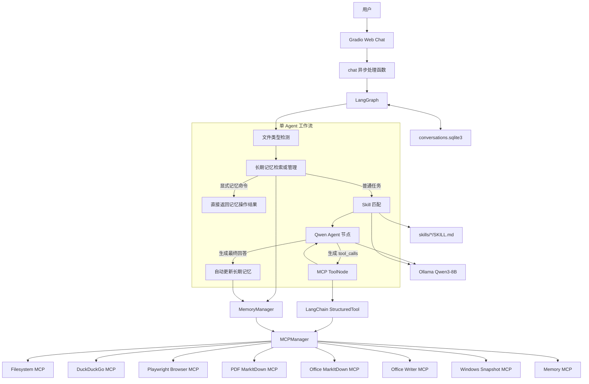
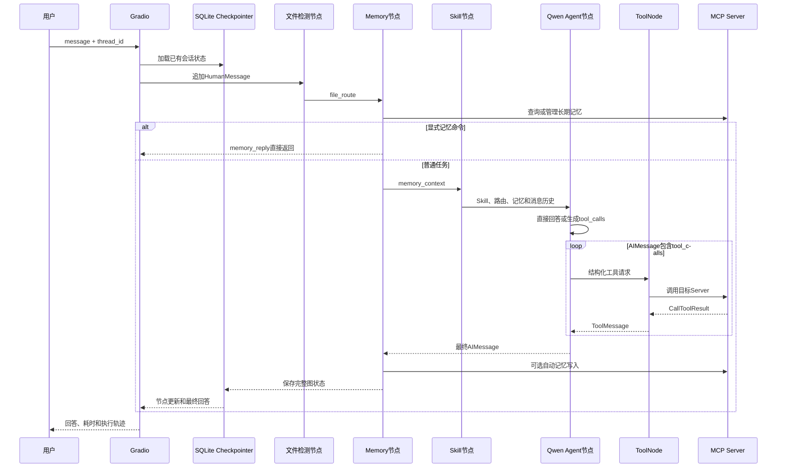

# Local Personal Agent

一个运行在 Windows 本地电脑上的个人智能体系统。

项目使用本地 Ollama `Qwen3-8B` 作为大语言模型，通过 LangGraph 组织 Agent 工作流，通过 MCP 接入文件系统、网络搜索、浏览器、PDF、Office、长期记忆和屏幕观察能力，并使用 Gradio 提供 Web 聊天界面。

> 当前实现是“单 Agent + 规则路由 + LLM 工具选择 + MCP 工具循环”，不是多智能体系统。项目中没有相互独立的 Planner Agent、File Agent、Research Agent 或 Computer Agent。

## 目录

- [当前能力](#当前能力)
- [技术栈](#技术栈)
- [整体架构](#整体架构)
- [目录结构](#目录结构)
- [启动流程](#启动流程)
- [一次请求的完整执行链路](#一次请求的完整执行链路)
- [任务识别与工具路由](#任务识别与工具路由)
- [Agent 运行机制](#agent-运行机制)
- [MCP 工具体系](#mcp-工具体系)
- [Skill 机制](#skill-机制)
- [Memory 与会话管理](#memory-与会话管理)
- [配置与持久化](#配置与持久化)
- [异常处理与安全边界](#异常处理与安全边界)
- [已知问题与限制](#已知问题与限制)
- [安装与启动](#安装与启动)
- [使用示例](#使用示例)
- [测试说明](#测试说明)
- [核心代码阅读顺序](#核心代码阅读顺序)

## 当前能力

### 已实现

- 使用 Ollama 本地运行 `qwen3:8b`。
- 使用 Gradio 提供本地 Web 聊天页面。
- 使用 LangGraph 管理消息状态和工具调用循环。
- 通过 Filesystem MCP 访问本地 D 盘文件系统。
- 通过 DuckDuckGo MCP 搜索网络并抓取网页正文。
- 通过隔离的 Playwright Edge 浏览器读取网页。
- 将 PDF、DOCX、XLSX、PPTX 转换成 Markdown 后交给模型分析。
- 通过项目自带的 MCP Server 创建并验证 DOCX 文件。
- 通过 Windows MCP 获取当前屏幕的结构化快照。
- 通过 SQLite Checkpointer 持久化短期会话。
- 通过 Memory MCP 保存、检索、更新和删除长期记忆。
- 按需发现并加载 `SKILL.md`。
- 在页面中显示节点级执行过程、调用工具、Skill 和 Memory 状态。

### 尚未实现

- Embedding、FAISS、Chroma、Milvus、Retriever 和 Reranker 等完整 RAG 知识库。
- 多 Agent 协作，以及独立的 Planner、Executor、Reflector 或 Validator Agent。
- 文件内容增量索引和长期论文知识库。
- 图片 OCR 或视觉文档分析工作流。
- 鼠标点击、键盘输入、程序启动等 GUI 控制。
- 通用敏感操作审批界面。
- 用户登录、身份认证和多用户数据隔离。

## 技术栈

| 类型 | 技术 |
|---|---|
| 操作系统 | Windows 11 |
| Python | Python 3.11 |
| Python 环境 | Conda `qwen_agent` |
| 本地模型 | Ollama + Qwen3-8B |
| LLM 客户端 | LangChain Ollama |
| Agent 编排 | LangGraph |
| 工具协议 | MCP |
| Web 界面 | Gradio |
| 短期会话 | LangGraph SQLite Checkpointer |
| 长期记忆 | Memory MCP JSONL 知识图谱 |
| 网络搜索 | DuckDuckGo MCP |
| 浏览器 | Playwright MCP + Microsoft Edge |
| PDF/Office 解析 | MarkItDown MCP |
| DOCX 创建 | python-docx |
| 屏幕观察 | Windows MCP |

当前项目虽然使用 Qwen 模型，但 Agent 编排已经从早期的 Qwen-Agent 演进为 LangGraph。

## 整体架构



## 目录结构

```text
D:\46-Agent
│
├── app.py                         # 应用入口、Gradio UI、生命周期和会话恢复
├── README.md
├── requirements.txt              # Python 核心依赖
├── start_agent.bat               # Windows 启动脚本
│
├── agent
│   ├── graph.py                  # LangGraph 节点和边
│   ├── nodes.py                  # 路由、Prompt、LLM 和搜索编排
│   └── state.py                  # AgentState 定义
│
├── mcp_client
│   ├── client.py                 # 构造 MCP stdio 参数
│   ├── config.json               # MCP Server 配置
│   ├── errors.py                 # MCP 异常类型
│   ├── health.py                 # Server 健康状态
│   ├── manager.py                # MCP 长生命周期 Session 管理
│   └── tools.py                  # MCP 到 LangChain 的工具适配层
│
├── mcp_servers
│   ├── office_writer_server.py   # 项目自实现的 DOCX MCP Server
│   ├── package.json
│   └── package-lock.json
│
├── memory
│   ├── manager.py                # 长期记忆管理
│   ├── models.py                 # 记忆数据模型
│   ├── policy.py                 # 记忆命令和敏感信息策略
│   ├── memory.jsonl              # 长期记忆运行数据，不提交 Git
│   └── conversations.sqlite3     # 短期会话运行数据，不提交 Git
│
├── skills
│   ├── loader.py                 # Skill 发现和加载
│   ├── news-search/SKILL.md
│   └── ppt-summary/SKILL.md
│
├── workspace                     # 浏览器输出、测试文件和运行日志
└── test_*.py                     # 单元和集成测试脚本
```

## 启动流程

### 启动脚本

运行：

```powershell
D:\46-Agent\start_agent.bat
```

脚本依次执行：

1. 检查 7860 端口。
2. 如果端口由命令行包含 `app.py` 的旧进程占用，则停止该进程。
3. 激活 Conda 环境 `qwen_agent`。
4. 切换到 `D:\46-Agent`。
5. 执行 `python app.py`。

### Python 初始化

`app.py` 启动后：

1. 创建模块级 `MCPManager` 和 `MemoryManager`。
2. 构建 Gradio 页面。
3. 检查 `127.0.0.1:7860` 是否可用。
4. 启动 Gradio，并进入 ASGI lifespan。
5. 创建或打开 `memory/conversations.sqlite3`。
6. 初始化 `AsyncSqliteSaver`。
7. 检查本地 Ollama；必要时尝试启动 `ollama serve`。
8. 检查 `qwen3:8b` 是否已经安装。
9. 顺序启动配置中的 MCP Server。
10. 获取并包装 MCP 工具定义。
11. 发现 Skill 元数据。
12. 编译 LangGraph。

应用关闭时会逆序关闭 MCP Session、stdio 连接和子进程，并释放 SQLite Checkpointer。

## 一次请求的完整执行链路



Gradio 当前展示节点级进度，不是逐 Token 流式输出。

## 任务识别与工具路由

项目采用“规则优先、模型补充”的混合路由。

### 文件类型路由

| 扩展名 | `file_route` | 推荐工具 |
|---|---|---|
| `.pdf` | `pdf` | `pdf_convert_to_markdown` |
| `.docx`、`.xlsx`、`.pptx` | `office` | `office_convert_to_markdown` |
| `.txt`、`.md`、`.py`、`.json` | `filesystem` | Filesystem MCP |
| `.png`、`.jpg`、`.jpeg` | `image_unsupported` | 不作为文本读取 |
| 无匹配 | `general` | 由模型决定 |

路由结果会转换成 SystemMessage 提示，但不会直接执行工具。

### 网络搜索路由

包含“搜索、检索、联网查、网上查、网络查”等表达的普通请求会优先构造 `search` 调用。本地文件搜索意图会被排除。

网络搜索的完整流程：

1. 调用 DuckDuckGo `search` 获取候选结果。
2. 从工具结果提取真实 URL。
3. 让未绑定工具的 Qwen 选择最可能包含答案的页面。
4. 调用 `fetch_content` 获取正文。
5. 让 Qwen 判断正文证据是否充分。
6. 不足时切换来源，最多尝试 5 个页面。
7. 证据足够后，使用未绑定工具的 Qwen 生成最终回答。

### Skill 路由

1. Office 路由且任务包含 PPT/PPTX 时，优先选择 `ppt-summary`。
2. 包含新闻、资讯、热搜、头条等关键词时，优先选择 `news-search`。
3. 其他任务把 Skill 名称和描述交给 Qwen 选择。
4. 只接受与已发现 Skill 名称完全一致的输出。
5. 没有明确匹配时不加载 Skill。

## Agent 运行机制

### 状态结构

| 字段 | 作用 |
|---|---|
| `messages` | 用户、模型和工具消息，使用 `add_messages` 追加 |
| `file_route` | 本轮文件类型分类 |
| `active_skill` | 当前命中的 Skill 名称 |
| `skill_instruction` | 已命中 Skill 的完整正文 |
| `memory_context` | 检索到的长期记忆 |
| `memory_status` | 记忆检索或更新状态 |
| `memory_direct_response` | 显式记忆操作的可信结果 |

主 Agent 每轮会接收：

1. 主系统提示和当前日期。
2. 已匹配 Skill 的完整正文。
3. 文件类型路由提示。
4. 与当前任务相关的长期记忆。
5. 最近最多 30 条、约 24,000 字符的消息。
6. MCP 工具的名称、描述和参数 Schema。

完整状态保存在 SQLite 中；裁剪只影响本轮送给模型的上下文。

模型返回 `tool_calls` 时进入：

```text
Agent → ToolNode → MCP工具 → ToolMessage → Agent
```

返回普通回答时进入自动记忆节点，然后结束本轮。项目没有独立任务计划、步骤队列或反思记录，多步任务依靠同一模型在工具循环中推进。

## MCP 工具体系

| Server | 作用 | 模型可见范围 |
|---|---|---|
| `filesystem` | 访问 D 盘文件系统 | Server 暴露的全部工具 |
| `duckduckgo-search` | 搜索和正文抓取 | `search`、`fetch_content` |
| `browser` | 隔离 Edge 浏览器 | `browser_navigate`、`browser_snapshot`、`browser_evaluate` |
| `pdf` | PDF 转 Markdown | 工具名前加 `pdf_` |
| `office` | Office 转 Markdown | 工具名前加 `office_` |
| `office-writer` | 创建 DOCX | `office_create_docx` |
| `memory` | JSONL 知识图谱 | 不暴露给通用 ToolNode |
| `computer` | Windows 屏幕观察 | 只暴露 `Snapshot` |

`MCPManager` 为每个 Server 保存长生命周期 Session、stdio 资源、独立关闭栈、工具缓存和调用锁。同一个 Server 的调用会串行执行，不同 Server 可以并发。单个 Server 启动失败会被隔离；只有所有 Server 均失败时才终止初始化。

`mcp_client/tools.py` 将 MCP 工具转换成 LangChain `StructuredTool`，负责工具名前缀、JSON Schema、文件参数校验、结果文本化和异常包装。Memory MCP 被排除在通用工具列表之外，只能由 `MemoryManager` 调用。

## Skill 机制

Skill 目录格式：

```text
skills
└── skill-name
    └── SKILL.md
```

每个 Skill 必须包含简单 frontmatter：

```markdown
---
name: news-search
description: 搜索、核验并整理最新新闻
---
```

`SkillLoader` 只扫描 `skills/*/SKILL.md`，校验名称、描述、重名和文件路径。单个 Skill 损坏时会被跳过，不影响其他 Skill。

Skill 不是独立程序。命中后，完整 `SKILL.md` 会作为 SystemMessage 注入模型；实际动作仍由 MCP 工具执行。

当前内置：

- `news-search`：搜索、核验并整理新闻或实时资讯。
- `ppt-summary`：读取并总结本地 PPTX 演示文稿。

## Memory 与会话管理

| 类型 | 存储位置 | 内容 | 检索方式 |
|---|---|---|---|
| 短期会话 | `memory/conversations.sqlite3` | 完整 LangGraph 状态 | `thread_id` |
| 长期记忆 | `memory/memory.jsonl` | 稳定事实和偏好 | 关键词与中文 n-gram |

### 短期会话

SQLite Checkpointer 保存用户消息、模型回复、工具调用、工具结果及其他图状态。浏览器保存最近的会话 ID。复制 ID，重启应用后填回并点击“恢复会话”，即可恢复历史。

### 长期记忆

一条记忆包含：

```text
memory_id、key、kind、content、source、created_at、updated_at、status
```

自然语言操作示例：

```text
记住，我的 Agent 项目路径是 D:\46-Agent。
你记住了哪些关于我的信息？
把我之前关于代码注释的偏好改成中英文结合。
忘记我之前关于新闻总结格式的记忆。
清空所有长期记忆。
```

清空全部记忆需要准确回复：

```text
确认清空所有长期记忆
```

当前长期记忆不是向量检索。它使用英文 token 和中文 2～4 字 n-gram 排序，最多向模型注入 5 条、总计约 3,000 字符。

自动记忆只考虑稳定偏好或配置。问题、搜索、文件读取和一次性任务通常不会保存。包含密码、验证码、银行卡、私钥、助记词、API Key、Token 等关键词的信息默认不保存，但该机制只是关键词过滤。

## 配置与持久化

### 配置位置

- 模型、Ollama URL、温度和上下文长度：`agent/nodes.py`。
- Gradio 地址、端口和会话数据库：`app.py`。
- MCP Server 命令、参数和工具白名单：`mcp_client/config.json`。
- Skill：`skills/*/SKILL.md`。
- 长期记忆策略：`memory/policy.py`。

模型参数：

```python
model="qwen3:8b"
base_url="http://127.0.0.1:11434"
temperature=0.2
reasoning=False
num_ctx=16384
```

### 持久化数据

| 数据 | 位置 | 重启后保留 |
|---|---|---|
| 完整会话状态 | `memory/conversations.sqlite3` | 是 |
| 长期记忆 | `memory/memory.jsonl` | 是 |
| 最近会话 ID | 浏览器 BrowserState | 是，取决于浏览器存储 |
| Browser MCP 输出 | `workspace/browser` | 文件可能保留 |
| MCP Session 和健康状态 | Python 内存 | 否 |
| Skill 目录缓存 | Python 内存 | 否 |

## 异常处理与安全边界

### 已有处理

- Ollama 查询超时 2 秒，自动启动最多等待 30 秒。
- Memory MCP 调用超时 10 秒。
- 单个 MCP Server 启动失败不会阻止其他 Server。
- MCP 工具异常会转换成结构化失败 JSON。
- 工具名冲突会在加载阶段报错。
- PDF 和 Office 本地路径需要存在、可读且扩展名正确。
- 普通文件工具会拒绝读取 PDF 和 Office 二进制文件。
- Browser MCP 使用 headless、isolated 模式，不复用日常浏览器登录状态。
- Computer MCP 只开放 `Snapshot`，没有鼠标、键盘、PowerShell 和注册表工具。
- Memory MCP 不直接暴露给模型。
- Memory 故障时普通聊天可以降级继续执行。

### 需要注意的权限边界

1. Filesystem MCP 根目录是整个 `D:\`，且没有 `includeTools` 白名单。运行时 Server 暴露的写入、编辑、建目录或移动工具也可能进入 Agent。
2. 当前没有通用人工审批机制，文件修改和 DOCX 创建不会先弹出确认页面。
3. Office Writer 可以创建父目录，并可能覆盖已有 DOCX。
4. PDF 和 Office 包装层接受 `http`、`https` 和 `data` URI，没有项目侧私网地址、域名和下载大小限制。
5. MCP 子进程继承父 Python 进程的环境变量。
6. 工具参数、工具结果和最终回答可能进入终端日志。
7. 单主题长期记忆删除不要求二次确认，并可能删除多条模糊匹配结果。
8. 网页、文件和工具返回仍会进入模型上下文。当前 Prompt Injection 防护主要依赖提示词，不是强制隔离机制。

## 已知问题与限制

### 搜索状态可能跨轮污染

搜索编排使用整个会话历史中的最后一条 ToolMessage，而不是只使用当前轮结果。因此新请求可能误用上一轮搜索结果，已访问 URL 和换源次数也会跨轮累计。

### PPT 支持声明不一致

`ppt-summary` 声称支持 PPT/PPTX，但文件路由和 Office 参数校验只允许 `.pptx`。

### 测试与错误格式不一致

`test_mcp_stability.py` 要求错误 JSON 包含 `suggestion`，当前 `_failure_payload()` 没有该字段。

### Python 依赖声明不完整

Office Writer 和相关测试直接使用 `python-docx`，但根 `requirements.txt` 没有声明它。

### 文件访问范围不一致

Filesystem MCP 只配置 D 盘，常见的 C 盘 Windows Desktop 不在其范围内；PDF 和 Office 工具却允许其他盘的绝对路径。

### 缺少统一超时和自动重连

普通 MCP 调用和 Server 初始化没有统一超时。工具失败后 Session 不会自动重建，健康状态后续成功时也不会自动恢复。

### 缺少项目级循环上限

网页换源有 5 次限制，但通用 `Agent → Tool → Agent` 循环没有项目自定义最大次数，主要依赖 LangGraph 默认递归限制。

### 上下文预算不精确

历史裁剪使用字符数，没有计算真实 token，也没有把 System Prompt、Skill、Memory、工具 Schema 和参数计入统一预算。

### MCP 依赖可复现性

Filesystem 使用未固定版本的：

```text
npx -y @modelcontextprotocol/server-filesystem
```

PDF 和 Office 还会分别启动一个相同实现的 MarkItDown MCP 进程。

## 安装与启动

### 1. 激活 Conda 环境

```powershell
conda activate qwen_agent
cd /d D:\46-Agent
```

### 2. 安装 Python 依赖

```powershell
python -m pip install -r requirements.txt
```

Office Writer 还需要 `python-docx`。如果当前环境没有安装：

```powershell
python -m pip install python-docx
```

### 3. 安装 Node MCP 依赖

```powershell
cd /d D:\46-Agent\mcp_servers
npm install
```

### 4. 准备 Ollama 模型

```powershell
ollama list
ollama pull qwen3:8b
```

### 5. 启动应用

```powershell
cd /d D:\46-Agent
python app.py
```

也可以运行：

```powershell
D:\46-Agent\start_agent.bat
```

### 6. 打开页面

```text
http://127.0.0.1:7860
```

## 使用示例

### 文件与文档

```text
请查看 D:\46-Agent 目录下有哪些文件
读取 D:\46-Agent\README.md 并总结项目结构
总结 D:\Papers\agent-security.pdf，分析研究问题、技术路线和实验结果
总结 D:\Slides\meeting.pptx，按主题整理主要结论
```

### 网络研究

```text
搜索最近一年关于 AI Agent Security 的论文，并总结常见攻击方法
搜索今天关于人工智能的重要新闻，按标题、摘要和来源整理
```

### 屏幕观察

```text
查看我当前电脑界面上有什么窗口和文字
```

### 长期记忆

```text
记住，我的 Agent 项目路径是 D:\46-Agent。
你记住了哪些关于我的信息？
把我之前关于代码注释的偏好改成中英文结合。
忘记我之前关于代码注释的记忆。
```

## 测试说明

项目测试主要是可直接运行的 Python 脚本，并非全部由统一测试框架管理。

| 文件 | 作用 |
|---|---|
| `test_graph.py` | 验证 HumanMessage、ToolMessage、AIMessage 链路 |
| `test_agent_behavior.py` | 验证新闻、PDF、PPTX、文本和目录任务路由 |
| `test_mcp_tools.py` | 验证关键 MCP 工具是否发现 |
| `test_mcp_stability.py` | 验证真实搜索、抓取、PDF 转换和错误结果 |
| `test_realtime_grounding.py` | 验证空结果和实时搜索证据链 |
| `test_memory.py` | 离线验证长期记忆逻辑 |
| `test_memory_persistence.py` | 验证 Memory 和 Checkpointer 跨进程持久化 |
| `test_skills.py` | 验证 Skill 发现、损坏隔离和匹配 |
| `test_office_docx.py` | 创建并验证真实 DOCX |
| `test_all_mcp.py` | 启动全部 MCP Server 并输出工具清单 |

部分测试会访问网络、启动子进程、读取真实文件、修改临时 Memory，或在桌面创建 DOCX。运行前应先阅读对应脚本。

## 核心代码阅读顺序

1. `app.py`：启动、Gradio、Ollama、MCP 生命周期和会话恢复。
2. `agent/state.py`：LangGraph 状态结构。
3. `agent/graph.py`：节点、条件边和工具循环。
4. `agent/nodes.py`：Prompt、文件路由、Skill、Memory、搜索和 LLM 决策。
5. `mcp_client/config.json`：MCP Server 和权限范围。
6. `mcp_client/manager.py`：MCP 子进程和 Session 生命周期。
7. `mcp_client/tools.py`：工具适配、参数校验和异常包装。
8. `skills/loader.py` 与 `skills/*/SKILL.md`：Skill 机制。
9. `memory/policy.py`：记忆命令、敏感信息和自动记忆规则。
10. `memory/models.py`：长期记忆的数据结构。
11. `memory/manager.py`：长期记忆的检索、保存、更新和删除。
12. `mcp_servers/office_writer_server.py`：项目自实现 MCP Server 的示例。
13. `test_*.py`：通过测试场景理解预期行为和外部依赖。

## 项目运行逻辑总结

用户在 Gradio 页面提交任务后，系统根据会话 ID 从 SQLite 恢复已有状态，并把本轮输入追加成 `HumanMessage`。LangGraph 首先识别用户是否提供了本地文件路径及其类型，然后由 Memory 节点处理显式记忆命令，或检索与当前任务相关的长期记忆。Skill 节点通过固定规则或一次 Qwen 判断选择适用 Skill，并在命中后加载完整 `SKILL.md`。主 Agent 节点把系统提示、Skill、文件路由、长期记忆和最近对话一起发送给本地 Qwen3-8B。模型可以直接回答，也可以生成结构化工具调用。ToolNode 将调用交给 MCPManager，再路由到文件系统、搜索、浏览器、PDF、Office 或屏幕观察 Server。工具结果作为 `ToolMessage` 回到 Agent，模型继续调用工具或基于真实结果生成最终回答。普通任务结束后，Memory 节点会根据保守规则判断是否保存稳定信息，完整图状态写入 SQLite，最终回答和执行轨迹返回 Gradio 页面。
